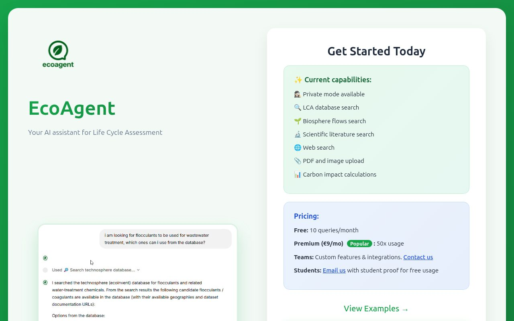
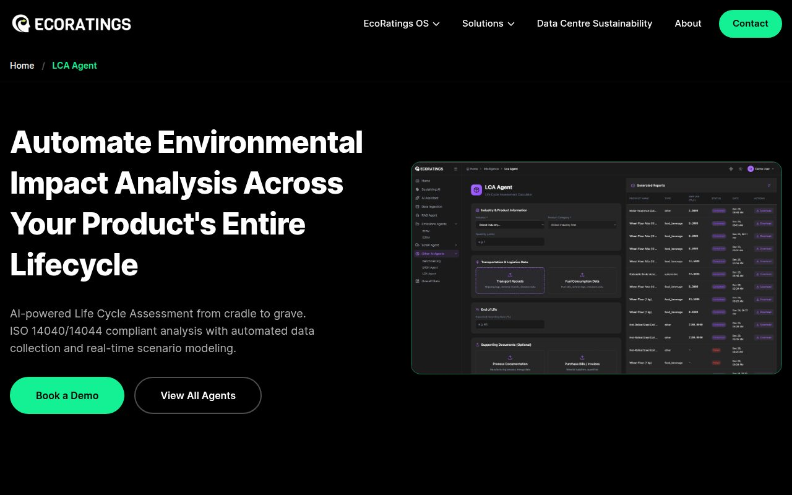

# Experiences from the use of <span class="hl">AI-based approaches</span> to enhance LCA workflows

<div class="authors">
<b>Gustavo Larrea-Gallegos</b>
</div>

<div class="affil">
<div>Environmental Sustainability Assessment and Circularity (SUSTAIN), Luxembourg Institute of Science and Technology, Luxembourg</div>
</div>

<div class="rule"></div>
<div class="event">NIES, Tsukuba, Japan</div>
<div class="date">November 13th, 2026</div>

---
clicks: 3
---

<div class="grid grid-cols-[0.7fr_1.6fr] gap-10 h-full items-center">

<style>
.toc .numrow { margin-bottom: 1.5rem; }
.toc .numrow .head { font-size: 1.2rem; }
.toc .numrow .body { font-size: 0.92rem; margin-top: 0.3rem; }
</style>

<div>
<div class="side-title">Outline</div>
</div>

<div class="toc">
<Step :from="0" class="numrow">
<div class="num">1</div>
<div><div class="head">AI in sustainability research</div>
<div class="body it">Sustainable AI vs AI for sustainability, and where our projects sit</div>
</div>
</Step>
<Step :from="1" class="numrow">
<div class="num">2</div>
<div><div class="head">CALIMERO: machine learning for data-gap filling</div>
<div class="body it">Predicting toxicity characterisation factors of chemicals</div>
</div>
</Step>
<Step :from="2" class="numrow">
<div class="num">3</div>
<div><div class="head">PINK: ChemLCI, an agentic LCI builder</div>
<div class="body it">Agentic AI drafting traceable inventories of chemicals in silico</div>
</div>
</Step>
<Step :from="3" class="numrow">
<div class="num">4</div>
<div><div class="head">MECO-EPD: agents navigating construction products</div>
<div class="body it">Classifying and extracting Environmental Product Declarations</div>
</div>
</Step>
</div>

</div>

---
clicks: 2
---

# Sustainable AI <span class="hl">and</span> AI for sustainability

## two sides of the same debate (van Wynsberghe, 2021)

<style>
.duo2 { display: grid; grid-template-columns: 1fr 1fr; gap: 1.6rem; margin-top: 1.4rem; }
.card2 { background: #fff; box-shadow: var(--shadow); padding: 1rem 1.2rem 1.1rem; border-top: 5px solid var(--ie-orange); transition: opacity 0.45s ease; }
.card2.off { opacity: 0.35; }
.card2 .k { font-size: 0.66rem; font-weight: 700; text-transform: uppercase; letter-spacing: 0.08em; color: var(--ie-orange); }
.card2 .name { font-weight: 800; font-size: 1.45rem; line-height: 1.2; margin: 0.15rem 0 0.5rem; }
.card2 ul { font-size: 0.86rem; }
.card2.dark { background: var(--ie-bg-dark); color: var(--ie-cream); }
.card2.dark ul > li::before { background: var(--ie-cream); }
</style>

<div class="duo2">
<div class="card2" :class="{ off: $clicks >= 2 }">
<div class="k">the sustainability of AI</div>
<div class="name">Sustainable AI</div>

- Reduce the footprint of AI itself: energy, water, carbon and materials
- Training, inference, data centres and hardware
- LCA <b>of</b> AI systems

</div>
<Step :from="1">
<div class="card2 dark">
<div class="k">AI as an instrument</div>
<div class="name">AI for sustainability</div>

- Use AI to accelerate sustainability goals and assessments
- Automation, data-gap filling, forecasting, decision support
- AI <b>for</b> LCA workflows

</div>
</Step>
</div>

<Step :from="2" class="callout mt-6" style="max-width:40rem">
This talk is about <b>AI for sustainability</b>: our experiences using AI to enhance LCA workflows. It is <b>not</b> about the footprint of AI.
</Step>

<div class="source">van Wynsberghe, A. (2021). Sustainable AI: AI for sustainability and the sustainability of AI. AI and Ethics, 1, 213-218</div>

---
clicks: 6
---

# AI for sustainability across the <span class="hl">green economy</span>

<div class="stack -mt-1 mb-1">
<Step :from="0" :to="1"><h2 style="margin:0">sectors of the green economy and the tasks AI is used for</h2></Step>
<Step :from="1" :to="2"><h2 style="margin:0">we leave Sustainable AI aside</h2></Step>
<Step :from="2" :to="3"><h2 style="margin:0">specific AI applications at LIST</h2></Step>
<Step :from="3" :to="4"><h2 style="margin:0">and the projects behind them</h2></Step>
<Step :from="4" :to="5"><h2 style="margin:0">CALIMERO: in-silico characterisation of chemicals</h2></Step>
<Step :from="5" :to="6"><h2 style="margin:0">PINK: in-silico environmental data and sustainability assessment agents (ChemLCI)</h2></Step>
<Step :from="6"><h2 style="margin:0">MECO-EPD: automatic parsing of environmental data of construction products</h2></Step>
</div>

<div class="flex justify-start -ml-2">
<SvgFigure src="fig-green-economy" width="790px"
  :show="{ '.task': 2, 'proj-band': 3, '.proj': 3 }"
  :focus="{ 1: ['grid', 'proj-band', '.task', '.proj'], 4: ['grid', 'proj-band', '.calimero'], 5: ['grid', 'proj-band', '.calimero', '.pink'], 6: ['grid', 'proj-band', '.calimero', '.pink', '.meco'] }" />
</div>

---
clicks: 2
---

# CALIMERO: AI for <span class="hl">data-gap filling</span>

## characterising the toxicity of chemicals for LCA with machine learning

<div class="grid grid-cols-[1fr_1.05fr] gap-8 items-start -mt-1">

<div class="text-[0.9rem]">
<Step :from="0" class="callout">
Many chemicals in an inventory have <b>no ecotoxicity or human toxicity characterisation factor (CF)</b> in EF 3.1: their impacts are silently counted as <b>zero</b>.
</Step>
<Step :from="1" class="mt-4">

- Start from the CFs of **5899 organic chemicals** in EF 3.1
- Standardise the SMILES: **5227** chemicals

</Step>
<Step :from="2" class="mt-2">

- Three molecular representations: **Mordred** descriptors, **Chemprop** molecular graphs, **GROVER** embeddings
- Filter missing, near-constant and correlated features, remove outliers: **4965** chemicals for training

</Step>
</div>

<div class="flex justify-center">
<SvgFigure src="fig-calimero-curation" width="415px"
  :show="{ standardize: 1, 'branch-mordred': 2, 'branch-chemprop': 2, 'branch-grover': 2 }" />
</div>

</div>

<div class="source">Ding, T., Larrea-Gallegos, G., Busio, F., Marvuglia, A., and Schaubroeck, T. (2026). RSC Sustainability, 4, 3426-3438</div>

---
clicks: 3
---

# Training and selecting <span class="hl">the best model per cluster</span>

<style>
.hm-call { font-size: 0.74rem; padding: 0.45rem 0.7rem; }
.hm-call b.r2 { color: var(--ie-orange); }
</style>

<div class="grid grid-cols-[1.3fr_1fr] gap-5 items-start mt-2">

<div>
<SvgFigure src="fig-calimero-training" width="100%"
  :show="{ 'predict-input': 1, 'predict-curated': 1, 'within-ad': 1, 'assign-cluster': 1, 'best-model': 1 }" />
<div class="stack text-[0.82rem] mt-3">
<Step :from="0" :to="1" class="callout small">
<b>Training</b>: machine learning and deep learning models, a chemical clustering and an applicability domain (AD) are fitted on the curated data. Performance is recorded <b>per model and per cluster</b>.
</Step>
<Step :from="1" class="callout small">
<b>Predicting</b>: a new SMILES is curated, checked against the AD, assigned to a cluster, and the <b>best model of that cluster</b> predicts its CF.
</Step>
</div>
</div>

<div>
<SvgFigure src="fig-calimero-performance" width="100%"
  :focus="{ 2: ['title', 'axes', 'colorbar', 'cell-r15-c9'], 3: ['title', 'axes', 'colorbar', 'cell-r15-c9', 'cell-r15-c8'] }" />
<div class="flex flex-col gap-2 mt-2">
<Step :from="2" class="callout hm-call">hh: non-agri soil, cluster 9: <b>MPNN_GE_M</b> on Mordred descriptors, <b class="r2">R2 = 0.72</b></Step>
<Step :from="3" class="callout hm-call">same target, cluster 8: <b>RF</b> on GROVER embeddings, only <b class="r2">R2 = 0.16</b></Step>
</div>
</div>

</div>

<div class="source">No single algorithm wins: the best model, representation and attainable accuracy depend on the chemical cluster. Ding et al. (2026)</div>

---
clicks: 2
---

# Case study: do the predicted CFs <span class="hl">change the results</span>?

## textile case study: pumice stone vs synthetic stone

<div class="grid grid-cols-[1.25fr_1fr] gap-7 items-center mt-1">

<div>
<SvgFigure src="fig-calimero-case-study" width="100%" :show="{ 'bars-with': 1 }" />
</div>

<div class="text-[0.9rem]">
<Step :from="0">

- Without predicted CFs, chemicals with no CF contribute nothing to toxicity

</Step>
<Step :from="1" class="mt-2">

- With predicted CFs, freshwater ecotoxicity rises by **39 %** (pumice) and **59 %** (synthetic stone)
- Human toxicity barely changes

</Step>
<Step :from="2" class="callout mt-4">
Filling the gaps does not flip the ranking here, but it changes the <b>size of the impacts</b> and the <b>ratio between options</b> (ecotoxicity: 2.0 > 1.8 times): missing CFs bias comparisons.
</Step>
</div>

</div>

<div class="source">Freshwater ecotoxicity in CTUe (left axis), human toxicity in CTUh (right axis). Ding et al. (2026)</div>

---

# The Safe and <span class="hl"> Sustainable </span> by Design framework


<div class="mt-3 flex justify-center">

</div>

<div class="source">Figure: Garmendia Aguirre et al. (2025), Safe and Sustainable by Design Chemicals and Materials. Revised framework (2025), JRC143022</div>

---
clicks: 1
---

# In silico assessment: *Fail <span class="hl">Early</span>, Fail <span class="hl">Cheap</span>*

## the earlier the stage, the simpler the LCA, and the more candidates to compare

<div class="grid grid-cols-[1.05fr_0.95fr] gap-8 items-center mt-2">

<div class="figcard">
<SvgFigure src="fig-lca-completeness"
  :dim="{ 'bar-plant': 1, 'bar-simulation': 1, 'bar-calculations': 1 }" />
</div>

<div class="text-[0.95rem]">
<Step :from="0" class="callout">
A core idea of SSbD: innovators should not find out that a chemical is <b>toxic</b> or <b>unsustainable</b> late in the process, or after its <b>market launch</b>.
</Step>
<Step :from="1" class="mt-5">

- At the **design-idea** stage we only have the **molecule**
- Many candidates, cheap changes: the LCA must be **fast, explorative and in silico**

</Step>
</div>
</div>

<div class="source">Figure: Larrea-Gallegos et al. (2025), adapted from Parvatker and Eckelman (2018)</div>

---
clicks: 3
hide: True
---

# Predicting impacts of <span class="hl">new chemicals</span>

## two methodological paths, and an agentic alternative

<div class="flex justify-center -mt-1">
<SvgFigure src="fig-paths" width="850px"
  :show="{ 'lane-p2': 1, 'lane-ours': 2, hitl: 3 }"
  :focus="{ 0: ['header', 'lane-p1'], 1: ['header', 'lane-p2'], 2: ['header', 'lane-ours'], 3: ['header', 'lane-ours', 'hitl'] }" />
</div>

<div class="source">Path 1: e.g. Zhang et al. (2024), Kleinekorte et al. (2023). Path 2: e.g. Langhorst et al. (2025)</div>

---
clicks: 4
---

# ChemLCI: an <span class="hl">agentic LCI builder</span> <span style="font-weight:500;font-size:1.05rem;color:var(--ie-orange)">(1 orchestrator, 7 agents, 8 steps)</span>

<div class="relative">
<div class="flex justify-center mt-2">
<SvgFigure src="fig-chemlci-arch" width="880px"
  :show="{ 'prompt-smiles': 1 }"
  :focus="{ 1: ['user', 'prompt-smiles', 'orchestrator', 'row-labels', 'step-1', 'step-2'], 2: ['user', 'prompt-smiles', 'orchestrator', 'row-labels', 'step-3', 'step-4'], 3: ['user', 'prompt-smiles', 'orchestrator', 'row-labels', 'step-5', 'step-6'], 4: ['user', 'prompt-smiles', 'orchestrator', 'row-labels', 'step-7', 'step-8'] }" />
</div>

<Step :from="3" :to="4" class="absolute s2i-float" style="right:0px; top:104px; width:214px">
<div class="block" style="padding:0.45rem 0.55rem 0.35rem">
<div class="flex items-baseline justify-between"><b class="accent small">smiles2impact</b><span class="tag hi" style="font-size:0.58rem">ML microservice</span></div>

<div class="tiny muted">Impacts predicted from molecular descriptors (Path 1) for inputs with no ecoinvent match. EF v3.1 climate change shown.</div>
</div>
</Step>
</div>

<style>
.s2i-float { transform: rotate(1.2deg); }
.s2i-float.step-hidden { transform: rotate(1.2deg) translateY(6px); }
</style>

---
clicks: 4
---

# There is a proliferation of <span class="hl">AI-based LCA tools</span>

<style>
.collage { display: grid; grid-template-columns: repeat(3, 1fr); gap: 9px; }
.shot { position: relative; background: #fff; box-shadow: var(--shadow); padding: 3px; }
.shot:nth-child(odd) { transform: rotate(-1.2deg); }
.shot:nth-child(even) { transform: rotate(0.9deg); }
.shot img { display: block; width: 100%; aspect-ratio: 16/10; object-fit: cover; object-position: top; }
.shot .cap { font-size: 0.55rem; line-height: 1.2; padding: 2px 2px 0; color: var(--ie-dark); }
.shot .cap b { color: var(--ie-orange); }
.shot.otf { display: flex; flex-direction: column; justify-content: center; align-items: center; text-align: center; background: var(--ie-bg-dark); color: var(--ie-cream); font-size: 0.66rem; padding: 0.5rem; }
.rim-src { max-width: 42.5rem; }
.duo { display: grid; grid-template-columns: 1fr auto 1fr; align-items: stretch; gap: 0.4rem; }
.duo-card { background: #fff; box-shadow: var(--shadow); padding: 0.5rem 0.65rem 0.5rem; border-top: 4px solid var(--ie-orange); }
.duo-card.dark { background: var(--ie-bg-dark); color: var(--ie-cream); }
.duo-k { font-size: 0.6rem; font-weight: 700; text-transform: uppercase; letter-spacing: 0.08em; color: var(--ie-orange); }
.duo-name { font-family: monospace; font-weight: 700; font-size: 1.05rem; line-height: 1.25; }
.duo-sub { font-size: 0.66rem; line-height: 1.3; font-style: italic; opacity: 0.85; margin-top: 0.1rem; }
.duo-plus { align-self: center; font-weight: 900; font-size: 1.7rem; color: var(--ie-orange); }
</style>

<div class="grid grid-cols-[1.15fr_1fr] gap-6 mt-2">

<div>
<div class="collage">
<div class="shot"><div class="cap"><b>Zhang et al. 2026</b>: multimodal LCA agents</div></div>
<div class="shot"><div class="cap"><b>SpiderGen</b>: LLM process flows for LCA</div></div>
<div class="shot"><div class="cap"><b>Donaldson et al. 2025</b>: LLMs-in-LCA benchmark</div></div>
<div class="shot"><div class="cap"><b>FAULDIER</b>: LLM-assisted LCI</div></div>
<div class="shot"><div class="cap"><b>openLCA MCP</b> server</div></div>
<div class="shot"><div class="cap"><b>TianGong LCA</b> MCP</div></div>
<div class="shot"><div class="cap"><b>EcoAgent</b>: AI assistant for LCA</div></div>
<div class="shot"><div class="cap"><b>EcoRatings</b>: LCA agent</div></div>
<div class="shot otf"><div><b>+ frontier models</b><br>writing an LCA calculator<br><i>on the fly</i></div><div class="mt-1" style="font-family:monospace;font-size:0.56rem;color:var(--ie-orange-lt)">&gt; build me a tool that…</div></div>
</div>
<div class="tiny muted mt-2">Screenshots of public pages, November 2026.</div>
</div>

<div class="text-[0.84rem]">
<Step :from="0">

- AI-based LCA tools appear every month: research agents, copilots, MCP servers
- Frontier models now even **implement such tools on the fly**

</Step>
<Step :from="1" class="callout small mt-3">
By analogy with <b>Rapid Application Development</b> in software, we are seeing a proliferation of <b>Rapid Inventory Modelling (RIM)</b> tools. 
</Step>
<Step :from="2" class="mt-3">

</Step>
<Step :from="3" class="mt-2">
<div class="block small" style="padding:0.55rem 0.8rem">
We need the <b>software that computes</b> and the <b>technology that makes it traceable</b> and interoperable.
</div>
</Step>

<Step :from="4" class="mt-3">
<div class="duo">
<div class="duo-card dark">
<div class="duo-k">computes</div>
<div class="duo-name">ChemLCI</div>
<div class="duo-sub">agents and ML tools draft the inventory</div>
</div>
<div class="duo-plus">+</div>
<div class="duo-card">
<div class="duo-k">traces</div>
<div class="duo-name">lca_models</div>
<div class="duo-sub">data models, ontologies and provenance</div>
</div>
</div>
</Step>

</div>
</div>

<div class="source rim-src">Zhang et al. (2026) Nature Electronics; Sitaraman et al. (2025) arXiv:2511.10684; Donaldson et al. (2025) arXiv:2510.19886; github.com/ljlazar/fauldier; github.com/Below280/B280-olca-MCP; github.com/linancn/tiangong-lca-mcp; ecoagent.tech; ecoratings.ai</div>

---
clicks: 1
hide: True
---

<style>
h1 { font-size: 1.55rem !important; }
</style>

# lca_models.<span class="hl">core</span> provides the semantic framework of LCA data

<div class="stack -mt-1 mb-1">
<Step :from="0" :to="1"><h2 style="margin:0">ontology view: what an inventory <i>means</i>, aligned with ORIONT, EMMO and the SSbD core</h2></Step>
<Step :from="1"><h2 style="margin:0">data model view: what an agent <i>must produce</i>, pydantic classes validate every output</h2></Step>
</div>

<div class="flex justify-start">
<SvgFigure src="fig-onto-core" width="830px" :show="{ uml: 1 }" :hide="{ onto: 1 }" />
</div>


---
clicks: 1
---

<style>
h1 { font-size: 1.55rem !important; }
</style>

# lca_models.<span class="hl">chemistry</span> provides semantics for the chemistry domain in LCA

<div class="stack -mt-1 mb-1">
<Step :from="0" :to="1"><h2 style="margin:0">ontology view: a route is a chain of reaction steps acting on EMMO molecules, bridged to LCI flows</h2></Step>
<!--<Step :from="1"><h2 style="margin:0">data model view: AiZynthFinder and ASKCOS both return a <i>RetrosynthesisRoute</i></h2></Step>-->
</div>

<div class="flex justify-start">
<SvgFigure src="fig-onto-chem" width="830px" :show="{ uml: 1 }" :hide="{ onto: 1 }" />
</div>


---

# Provenance <span class="hl">by design</span>: the run is a graph

## PROV-O, SSbD core ontology and lcont, recorded at runtime by ChemLCI

<div class="flex justify-center -mt-1">
<SvgFigure src="fig-prov-layers" width="935px" />
</div>

<!--# Provenance <span class="hl">by design</span>: the ontology behind the graph

## provenance classes of LifeCycleOnto.ttl that adk_prov writes into prov_&lt;run&gt;.ttl

<div class="flex justify-start">
<SvgFigure src="fig-onto-prov" width="830px" />
</div>-->

---
clicks: 5
---

# Octocrylene: from <span class="hl">one sentence</span> to an LCI

## UV filter used in sunscreens: “I want LCI for Octocrylene produced in Europe.”

<div class="flex justify-center -mt-1">
<SvgFigure src="fig-octocrylene-route" width="920px"
  :show="{ completed: 1, 'bw-cut': 2, gaps: 3, s2i: 4, foreground: 5 }" />
</div>


---

# Outputs are <span class="hl">data objects</span>, not text

## artefacts of the Octocrylene run

<script setup>
import bw from './data/octocrylene/bw_inventory.json'
import lcia from './data/octocrylene/lcia_results.json'
import route from './data/octocrylene/completed_route.json'
import retro from './data/octocrylene/retro_0.json'
const cc = lcia.scores.find(s => s.category_key.endsWith('climate change / global warming potential (GWP100)')) ?? lcia.scores[1]
const tabs = [
  { step: '2', label: 'retro_0.json', cls: 'RetrosynthesisRoute', data: retro, open: 2 },
  { step: '3', label: 'completed_route.json', cls: 'SynthesisRoute', data: route, open: 1 },
  { step: '6', label: 'bw_inventory.json', cls: 'Inventory', data: bw, open: 2 },
  { step: '7', label: 'lcia_results.json', cls: 'LCIAResult', data: lcia, open: 1 },
]
</script>

<div class="grid grid-cols-[2.1fr_1fr] gap-5 -mt-1">
<JsonExplorer :tabs="tabs" :initial="2" height="318px" />

<div class="flex flex-col gap-3">
<div class="block text-center">
<div class="tiny muted">EF v3.1 climate change</div>
<div style="font-weight:900;font-size:2rem;color:var(--ie-orange);line-height:1.1">{{ cc.score.toFixed(2) }}</div>
<div class="small"><b>{{ cc.unit }}</b> / kg octocrylene</div>
<div class="tiny muted mt-1">21 EF v3.1 categories, Brightway 2.5, ecoinvent 3.12 cut-off</div>
</div>
<div class="block small">
<b>2</b> foreground activities<br><b>7</b> ecoinvent nodes, each with its <i>code</i><br><b>iri</b> + <b>ssbd_class</b> on every score
</div>
<div class="callout tiny">A <b>draft</b>: two precursors are missing, candidates for <b>smiles2impact</b>. Directly reusable in Brightway or any other engine.</div>
</div>
</div>

---

# Tracing back <span class="hl">how the agents computed</span>

## workflow &gt; step &gt; agents and tools

<ProvTimeline :initial="6" />

---

# Tracing back <span class="hl">how the agents computed</span>

## output &gt; lineage: click an exchange of the inventory

<div style="height:25.5rem"><ProvTrace initial="Toluene" /></div>

---
clicks: 2
---

# Limitations and <span class="hl">next steps</span>

<style>
.numrow .head { font-size: 1.2rem; }
.numrow .body { font-size: 0.95rem; margin-top: 0.3rem; }
</style>

<div class="flex flex-col gap-y-9 mt-12" style="max-width:44rem">
<Step :from="0" class="numrow">
<div class="num">1</div>
<div><div class="head">Validation and error propagation</div>
<div class="body it">Benchmark drafts against reference LCIs; propagate the uncertainty already tagged on every object and tool.</div></div>
</Step>
<Step :from="1" class="numrow">
<div class="num">2</div>
<div><div class="head">Making the provenance usable</div>
<div class="body it">The final orchestrator summary describes a 7-step route, but the provenance graph is huge! We need to design visualization instruments to maximise the use of the provenance graph for final users.</div></div>
</Step>
<Step :from="2" class="numrow">
<div class="num">3</div>
<div><div class="head">Expert rationale and cost</div>
<div class="body it">Energy, solvents and emissions are LLM heuristics: bring in industrial expert rules and human review. One route: ~18 min, ~4.9 M tokens with a small model.</div></div>
</Step>
</div>


---
clicks: 2
---

# MECO-EPD: <span class="hl">motivation</span>

## using agentic AI workflows to navigate the space of construction products in LCA

<style>
.mot { display: grid; grid-template-columns: 2.4rem 1fr; gap: 0 0.8rem; align-items: start; margin-bottom: 1rem; font-size: 0.86rem; line-height: 1.36; }
.mot .num { width: 2.4rem; height: 2.4rem; background: var(--ie-bg-dark); color: var(--ie-cream); font-weight: 900; font-size: 1.5rem; line-height: 2.4rem; text-align: center; }
.symbols { position: relative; height: 19rem; }
.sym { position: absolute; background: #fff; box-shadow: var(--shadow); padding: 0.3rem 0.6rem; font-size: 0.74rem; line-height: 1.3; white-space: nowrap; }
.sym.green { border-left: 4px solid #6ea880; }
.sym.dark { border-left: 4px solid var(--ie-dark); }
.sym .lang { font-weight: 700; color: var(--ie-orange); margin-right: 0.25rem; }
.sym-obj { position: absolute; left: 50%; top: 50%; transform: translate(-50%, -50%); text-align: center; font-weight: 800; font-size: 1rem; color: var(--ie-dark); }
.sym-obj .q { font-size: 2.4rem; font-weight: 900; color: var(--ie-orange); line-height: 1; }
</style>

<div class="grid grid-cols-[1.15fr_1fr] gap-8 items-start mt-1">

<div>
<Step :from="0" class="mot">
<div class="num">1</div>
<div>Decarbonising buildings and construction depends on <b>transparent life cycle data</b>. <b>Environmental Product Declarations (EPDs)</b> report the environmental performance of construction products.</div>
</Step>
<Step :from="1" class="mot">
<div class="num">2</div>
<div>Many EPDs are published worldwide <b>without a common product classification or data schema</b>: information is missing or not machine readable, a barrier to analysing or retrieving EPDs.</div>
</Step>
<Step :from="2" class="mot">
<div class="num">3</div>
<div>We developed an <b>AI system that extracts structured data</b> by navigating a predefined EPD data model in an agentic manner, for EPD data consumers of the <b>Luxembourgish construction sector</b>.</div>
</Step>
</div>

<Step :from="1">
<div class="symbols">
<div class="sym green" style="left:0.5rem; top:0.6rem">Steel &gt; StructuralSteel &gt; WeldedSteelSections</div>
<div class="sym green" style="left:3.5rem; top:3.4rem"><span class="lang">FR</span>Profil Reconstitué Soudé acier</div>
<div class="sym green" style="left:7rem; top:5.6rem"><span class="lang">EN</span>Welded Steel Section steel</div>
<div class="sym-obj"><div class="q">?</div>same product,<br>different symbols</div>
<div class="sym dark" style="left:0.5rem; top:12.4rem">Masonry &gt; CMU</div>
<div class="sym dark" style="left:5rem; top:14.6rem"><span class="lang">FR</span>Briques en béton de laitier</div>
<div class="sym dark" style="left:2rem; top:16.8rem"><span class="lang">EN</span>Slag concrete bricks</div>
</div>
</Step>

</div>

<Step :from="2" class="source">Practitioners use different symbols for the same product: what it <i>is</i> (material) or what it <i>does</i> (function).</Step>

---
clicks: 5
---

# Problem statement: <span class="hl">symbols</span>, objects and interpretants

<style>
.triad { position: absolute; right: 1.2rem; top: 0.4rem; width: 260px; }
</style>

<div class="stack mb-1">
<Step :from="0" :to="1"><h2 style="margin:0">triadic semiotics (Peirce): a sign stands for an object to someone, through an interpretant</h2></Step>
<Step :from="1" :to="2"><h2 style="margin:0">data consumers and data producers both use symbols, but not the same ones</h2></Step>
<Step :from="2" :to="3"><h2 style="margin:0">retrieval: iterate from consumer symbols to producer symbols until the right data object is found</h2></Step>
<Step :from="3" :to="4"><h2 style="margin:0">each iteration costs the consumer, even more when the consumer is an LLM agent</h2></Step>
<Step :from="4" :to="5"><h2 style="margin:0">better semantic representations (taxonomies, data models) can be indexed: fewer iterations</h2></Step>
<Step :from="5"><h2 style="margin:0">cheaper for the consumers, but the cost moves to the producers, who must represent and annotate their data</h2></Step>
</div>

<div class="relative">
<div class="flex justify-center">
<SvgFigure src="fig-meco-problem" width="880px"
  :show="{ provider: 1, 'terms-provider': 1, 'nlp-direct': 2, 'consumer-ai': 3, 'semantic-left': 4, 'semantic-right': 4, indexing: 4, 'cost-left': 5, 'cost-right': 5 }"
  :hide="{ problem1: 0, problem2: 0 }" />
</div>

<Step :from="0" :to="1" class="triad">
<SvgFigure src="fig-triad" />
</Step>
</div>

---
clicks: 2
---

# The ideal system and its <span class="hl">two problems</span>

<div class="grid grid-cols-[1.55fr_1fr] gap-6 items-center mt-2">

<div>
<SvgFigure src="fig-meco-problem" width="100%"
  :show="{ problem1: 1, problem2: 2 }"
  :focus="{ 1: ['problem1', 'object', 'consumer-human', 'consumer-ai', 'terms-consumer', 'semantic-left', 'cost-left', 'indexing'], 2: [] }" />
</div>

<div class="text-[0.88rem]">
<div class="callout">
Ideally, one <b>semantic representation</b> minimises the iterations from the symbols of the users to the symbols of the producers.
</div>
<Step :from="1" class="numrow mt-5">
<div class="num">1</div>
<div><div class="head">Representation</div>
<div class="body it">The data model must represent the space of products with enough semantic granularity.</div></div>
</Step>
<Step :from="2" class="numrow mt-2">
<div class="num">2</div>
<div><div class="head">Annotation</div>
<div class="body it">The data of the producers must be annotated against that representation.</div></div>
</Step>
</div>

</div>

---
clicks: 2
---

# Problem 1: <span class="hl">representation</span>, and cptax

<div class="grid grid-cols-[1fr_1.05fr] gap-8 items-center mt-4">

<div class="text-[0.92rem]">
<Step :from="0">

- EPD retrieval with **weak semantic representations** can require several human-computer iterations until the right match is found
- Data models help, but they must represent the space of products with **enough semantic granularity**

</Step>
<Step :from="1" class="callout mt-5">
<b>cptax</b>, a construction product taxonomy: we adapted a generic data model (<b>OpenEPD</b>) to cover a sample of <b>100 Luxembourgish product symbols</b>.
</Step>
<Step :from="2" class="mt-4 small">

- 118 of 351 categories differ from OpenEPD: modified, moved, new or dropped

</Step>
</div>

<div class="flex justify-center">
<SvgFigure src="fig-cptax-waffle" width="420px"
  :show="{ unchanged: 1, modified: 1, moved: 1, new: 1, dropped: 1, caption: 1 }"
  :focus="{ 2: ['modified', 'moved', 'new', 'dropped', 'caption'] }" />
</div>

</div>

---
clicks: 4
---

# Problem 2: <span class="hl">annotation</span>, an agentic workflow

<div class="stack mb-1">
<Step :from="0" :to="2"><h2 style="margin:0">providers use different taxonomies and data assets, and a massive body of EPDs (~50k) would still need annotation</h2></Step>
<Step :from="2" :to="4"><h2 style="margin:0">the classification agent explores cptax level by level, reasoning only over the categories of one level</h2></Step>
<Step :from="4"><h2 style="margin:0">the data model of the identified path becomes a JSON schema: the response format of the extraction agent</h2></Step>
</div>

<div class="grid grid-cols-[300px_430px] gap-12 justify-center items-start">

<div>
<SvgFigure src="fig-meco-classification" width="100%"
  :show="{ extraction: 1, database: 1 }"
  :focus="{ 2: ['classification'], 4: ['extraction'] }" />
</div>

<div>
<SvgFigure src="fig-meco-exploration" width="100%"
  :show="{ cptax: 2, exploration: 3, 'step-1': 3, 'step-2': 3, 'step-3': 3, 'step-4': 3, isolated: 4, schema: 4, extraction: 4, output: 4 }" />
</div>

</div>

---
clicks: 5
---

# Experiences <span class="hl">and</span> recommendations

<style>
.xp-col h3 { font-size: 0.8rem; text-transform: uppercase; letter-spacing: 0.08em; color: var(--ie-orange); margin-bottom: 0.9rem; }
.xp-col .numrow { margin-bottom: 1.15rem; }
.xp-col .numrow .head { font-size: 1rem; }
.xp-col .numrow .body { font-size: 0.84rem; }
</style>

<div class="grid grid-cols-2 gap-10 mt-6">

<div class="xp-col">
<h3>experiences</h3>
<Step :from="0" class="numrow">
<div class="num">1</div>
<div><div class="head">Unpredictable cost</div>
<div class="body it">PDF size cannot be anticipated, so the cost per classified EPD can increase considerably.</div></div>
</Step>
<Step :from="1" class="numrow">
<div class="num">2</div>
<div><div class="head">Ambiguous taxonomies</div>
<div class="body it">An ambiguous taxonomy can lead to dead ends or multi-class issues during graph exploration.</div></div>
</Step>
<Step :from="2" class="numrow">
<div class="num">3</div>
<div><div class="head">Limited generalisation</div>
<div class="body it">cptax is a closed-world solution to an open-world problem.</div></div>
</Step>
</div>

<div class="xp-col">
<h3>recommendations</h3>
<Step :from="3" class="numrow">
<div class="num">1</div>
<div><div class="head">EPD footprints</div>
<div class="body it">Generating EPD "footprints" can prevent unnecessary token consumption.</div></div>
</Step>
<Step :from="4" class="numrow">
<div class="num">2</div>
<div><div class="head">Multidimensional taxonomies</div>
<div class="body it">The OpenEPD taxonomy has one axis; material, function and domain axes allow less ambiguous classifications.</div></div>
</Step>
<Step :from="5" class="numrow">
<div class="num">3</div>
<div><div class="head">Application-level ontologies</div>
<div class="body it">A future solution can use an application-level ontology to identify undefined products.</div></div>
</Step>
</div>

</div>

---
clicks: 2
---

# Research <span class="hl">directions</span>

<style>
.numrow .head { font-size: 1.2rem; }
.numrow .body { font-size: 0.95rem; margin-top: 0.3rem; }
</style>

<!-- PLACEHOLDER: research directions, to be filled in -->

<div class="flex flex-col gap-y-9 mt-12" style="max-width:44rem">
<Step :from="0" class="numrow">
<div class="num">1</div>
<div><div class="head">[Research direction 1]</div>
<div class="body it">[placeholder]</div></div>
</Step>
<Step :from="1" class="numrow">
<div class="num">2</div>
<div><div class="head">[Research direction 2]</div>
<div class="body it">[placeholder]</div></div>
</Step>
<Step :from="2" class="numrow">
<div class="num">3</div>
<div><div class="head">[Research direction 3]</div>
<div class="body it">[placeholder]</div></div>
</Step>
</div>
---
layout: end
---

# Thank <span class="hl">you</span>

<div class="contact">
<div class="lbl">contact information</div>
<div> gustavo.larrea@list.lu </div>
<div style="font-weight:700">Gustavo Larrea-Gallegos</div>
<div><i>Luxembourg Institute of Science and Technology (LIST)</i></div>
</div>

<div class="funders">
<div class="f-row">

<div class="f-sep"></div>


</div>
</div>

<!-- TODO: add the funders of CALIMERO and MECO-EPD (logos in .f-row and text below) -->

<div class="f-txt">PINK has received funding from the European Union's Horizon Europe Research and Innovation programme under grant agreement <span style="white-space:nowrap">No. 101137809</span>.</div>

<style>
.funders { position: absolute; left: 2.7rem; bottom: 1.6rem; }
.funders .f-row { display: flex; align-items: center; gap: 1.3rem; }
.funders img { display: block; flex-shrink: 0; }
.funders .f-pink { height: 32px; }
.funders .f-sep { width: 1px; height: 40px; background: #5a5a5a; }
.funders .f-eu { height: 32px; }
.funders .f-sbfi { height: 50px; }
.funders .f-ukri { height: 32px; }
.f-txt { position: absolute; left: 50%; top: 19.5rem; transform: translateX(-50%); width: 40rem; text-align: center; font-size: 1.15rem; line-height: 1.45; font-weight: 500; color: var(--ie-cream); }
</style>

---
layout: section
---

# Supplementary <span class="hl">material</span>

---

# Tool registry

## every tool is annotated with <code>@chemlci_tool</code>; the metadata is written into the provenance graph

<table class="list-table mt-1">
<thead><tr><th style="width:17%">module</th><th style="width:43%">tool</th><th style="width:22%">type</th><th>uncertainty level</th></tr></thead>
<tbody>
<tr><td>pubchem / chemistry</td><td>get_chemical_from_pubchem, get_molecule_from_cir</td><td>database lookup</td><td>0</td></tr>
<tr><td>retrosynthesis</td><td>predict_retrosynthesis (AiZynthFinder | ASKCOS), choose_retrosynthesis_route</td><td>emmo:MachineLearningModel</td><td>2, 0</td></tr>
<tr><td>chemistry (RDKit)</td><td>split_reaction_smiles, balance_reaction_smiles</td><td>deterministic</td><td>0</td></tr>
<tr><td></td><td>identify_missing_atoms, suggest_byproduct_combinations, suggest_coreactant_combinations</td><td>heuristic search</td><td>2, 3</td></tr>
<tr><td>validators</td><td>equation_format_validator, validate_equation_balance, draft_format_validator, validate_bw_inventory</td><td>pydantic / lca_models</td><td>0</td></tr>
<tr><td>brightway</td><td>search_ecoinvent_processes, search_ecoinvent_flows, get_biosphere_flow, get_process_node</td><td>database search</td><td>0, 1</td></tr>
<tr><td></td><td>get_activities_embeddings</td><td>semantic (embedding) search</td><td>3</td></tr>
<tr><td></td><td><b class="accent">smiles2impact</b> (new)</td><td>emmo:MachineLearningModel</td><td>3</td></tr>
<tr><td>lcia</td><td>search_lcia_methods, run_lcia</td><td>Brightway 2.5</td><td>0</td></tr>
<tr><td>io / session</td><td>save_json, load_json, save_location, go_to_task</td><td>state</td><td>0</td></tr>
</tbody>
</table>

---

# lca_models with <span class="hl">erdantic</span>

## entity-relationship diagrams generated directly from the pydantic models

<div class="grid grid-cols-3 gap-4 items-start mt-2">
<div><div class="small"><b>Inventory</b></div><SvgFigure src="erd-inventory" /></div>
<div><div class="small"><b>LCIAResult</b></div><SvgFigure src="erd-lcia" /></div>
<div><div class="small"><b>SynthesisRoute</b></div><SvgFigure src="erd-synthesis" /></div>
</div>

---
clicks: 3
---

# lca_models: python fields and <span class="hl">RDF predicates</span>

<div class="relative -mt-1">
<SvgFigure src="fig-lca-models-uml" width="880px"
  :show="{ 'chem-iri': 1, 'lci-iri': 1, 'lcia-iri': 1, 'chem-rdf': 2, 'lci-rdf': 2, 'lcia-rdf': 2, 'base-rdf': 2 }"
  :hide="{ 'chem-py': 2, 'lci-py': 2, 'lcia-py': 2, 'base-py': 2 }" />

<div class="stack absolute" style="left:4px; top:318px; width:168px">
<Step :from="0" :to="1" class="callout tiny"><b>pydantic classes</b> define and <b>validate</b> every agent output.<br>Octocrylene run: 6 LLM-invented UUIDs rejected.</Step>
<Step :from="1" :to="2" class="callout tiny">each class is bound to an <b>ontology class</b>:<br><code>@ontology_class("Flow", prefix="oriont")</code><br><span style="color:#2f7fb5">ssbd</span>, <span style="color:#80350e">oriont</span>, <span style="color:#7a4ea3">emmo</span>, <span style="color:#f46524">lcont</span></Step>
<Step :from="2" :to="3" class="callout tiny">each field carries its <b>RDF predicate</b>: <code>to_rdf_node()</code> writes JSON-LD straight into the provenance graph; content-hash IRIs (the same ecoinvent code gives the same IRI).</Step>
<Step :from="3" class="callout tiny"><b>interoperability</b>: AiZynthFinder and ASKCOS both return a <code>RetrosynthesisRoute</code>; an <code>Inventory</code> imports into Brightway.</Step>
</div>
</div>

---

# Querying the provenance graph

## SPARQL: which tool call chose each ecoinvent node, and among how many candidates?

<div class="grid grid-cols-[1.1fr_1fr] gap-5 mt-1">

```sparql {all|3-5|6-9|all}
SELECT ?activity ?ecoinvent ?query ?agent
       (COUNT(?cand) AS ?candidates) WHERE {
  ?node  rdfs:label ?activity ;
         prov:wasDerivedFrom ?eco .
  ?eco   a lcont:BackgroundActivity ; rdfs:label ?ecoinvent .
  ?call  lcont:selectedActivity ?eco ;
         lcont:searchQuery ?query ;
         lcont:returnedCandidate ?cand ;
         prov:wasAssociatedWith ?agent .
  ?agent a lcont:LLMAgent .
} GROUP BY ?activity ?ecoinvent ?query ?agent
```

<table class="list-table">
<thead><tr><th>activity</th><th>selected ecoinvent node</th><th>query</th><th>#</th></tr></thead>
<tbody>
<tr><td>2-Ethylhexanol</td><td>market for 2-ethylhexanol</td><td>2-ethylhexanol</td><td>4</td></tr>
<tr><td>Toluene</td><td>market for toluene, liquid</td><td>toluene</td><td>10</td></tr>
<tr><td>Heat, process</td><td>market for heat, from steam, in chemical industry</td><td>market for heat</td><td>10</td></tr>
<tr><td>Ethanol</td><td>market for ethanol, without water, 99.7%, from ethylene</td><td>ethanol</td><td>9</td></tr>
<tr><td>Piperidine</td><td>piperidine production</td><td>piperidine</td><td>2</td></tr>
<tr><td>Piperidine</td><td>piperidine production</td><td><span class="accent"><b>nickel metal</b></span></td><td>10</td></tr>
</tbody>
</table>
</div>

<div class="tiny muted mt-2">Results for the Octocrylene run (excerpt, 14 rows). Queries also surface records to review, e.g. a “nickel metal” search linked to <i>piperidine production</i>.</div>

---

# LCIA results <span class="hl">(Octocrylene draft)</span>

<script setup>
import lcia from './data/octocrylene/lcia_results.json'
</script>

<div class="refs" style="columns:2;font-size:0.62rem">
<table class="list-table">
<thead><tr><th>EF v3.1 category</th><th style="text-align:right">score</th><th>unit</th></tr></thead>
<tbody>
<tr v-for="s in lcia.scores" :key="s.iri"><td>{{ s.indicator.name }}</td><td style="text-align:right">{{ s.score.toPrecision(3) }}</td><td>{{ s.unit }}</td></tr>
</tbody>
</table>
</div>

<div class="tiny muted mt-2">1 kg octocrylene, cradle-to-gate, ecoinvent 3.12 cut-off, Brightway 2.5. Draft: benzophenone and ethyl cyanoacetate are not included.</div>

---

# References

<div class="refs mt-1">

<p>Caldeira, C., Farcal, L., Garmendia Aguirre, I., et al. (2022). <i>Safe and sustainable by design chemicals and materials: Framework for the definition of criteria and evaluation procedure for chemicals and materials</i>. EUR 31100 EN, Publications Office of the European Union, Luxembourg.</p>
<p>Ding, T., Larrea-Gallegos, G., Busio, F., Marvuglia, A., and Schaubroeck, T. (2026). Characterizing chemical toxicity for life cycle assessment using machine learning and deep learning models based on environmental footprint: methodological comparison and textile case study. <i>RSC Sustainability</i>, 4, 3426-3438. https://doi.org/10.1039/d6su00023a</p>
<p>Donaldson, A., Balaji, B., Oriekezie, C., Kumar, M., and Patouillard, L. (2025). An expert-grounded benchmark of general purpose LLMs in LCA. <i>arXiv:2510.19886</i>.</p>
<p>Garmendia Aguirre, I., Abbate, E., Bracalente, G., Mancini, L., Cappucci, G. M., et al. (2025). <i>Safe and Sustainable by Design Chemicals and Materials. Revised framework (2025)</i>. Bracalente, G., Abbate, E., and Garmendia Aguirre, I. (editors). Publications Office of the European Union, Luxembourg. https://data.europa.eu/doi/10.2760/5103785, JRC143022.</p>
<p>Genheden, S., Thakkar, A., Chadimová, V., Reymond, J.-L., Engkvist, O., and Bjerrum, E. (2020). AiZynthFinder: a fast, robust and flexible open-source software for retrosynthetic planning. <i>Journal of Cheminformatics</i>, 12, 70.</p>
<p>Kleinekorte, J., et al. (2023). <i>[complete reference as cited in the LCM 2025 deck]</i></p>
<p>Langhorst, T., et al. (2025). <i>[complete reference as cited in the LCM 2025 deck]</i></p>
<p>Larrea-Gallegos, G. M., Hofer, S., Hofstätter, N., Punz, B., Watzek, N., Lölsberg, W., … and Himly, M. (2025). Integrate &amp; balance aspects for safe and sustainable innovation: Needs analysis on SSbD categories and product development stage requirements to cover the entire life cycle.</p>
<p>Lebo, T., Sahoo, S., and McGuinness, D. (2013). <i>PROV-O: The PROV Ontology</i>. W3C Recommendation.</p>
<p>Mutel, C. (2017). Brightway: An open source framework for Life Cycle Assessment. <i>Journal of Open Source Software</i>, 2(12), 236.</p>
<p>Parvatker, A. G., and Eckelman, M. J. (2018). Comparative evaluation of chemical life cycle inventory generation methods and implications for life cycle assessment results. <i>ACS Sustainable Chemistry and Engineering</i>, 7, 350.</p>
<p>Sitaraman, A., Balaji, B., and Agarwal, Y. (2025). SpiderGen: Towards procedure generation for carbon life cycle assessments with generative AI. <i>arXiv:2511.10684</i>.</p>
<p>Tu, Z., et al. (2025). ASKCOS: open-source, data-driven synthesis planning. <i>Accounts of Chemical Research</i>.</p>
<p>van Wynsberghe, A. (2021). Sustainable AI: AI for sustainability and the sustainability of AI. <i>AI and Ethics</i>, 1, 213-218.</p>
<p>Zhang, Z., et al. (2026). Sustainability assessment using multimodal AI agents. <i>Nature Electronics</i> (arXiv:2507.17012).</p>
<p>Zhang, et al. (2024). <i>[complete reference as cited in the LCM 2025 deck]</i></p>
<p>SSbD core ontology: https://w3id.org/ssbd/. ORIENTING ontology (ORIONT): https://orienting.eu/oriont. EMMO: https://w3id.org/emmo. VOWL notation: Lohmann et al. (2016). PINK: https://pink-project.eu. openEPD: Building Transparency, https://www.buildingtransparency.org</p>

</div>
